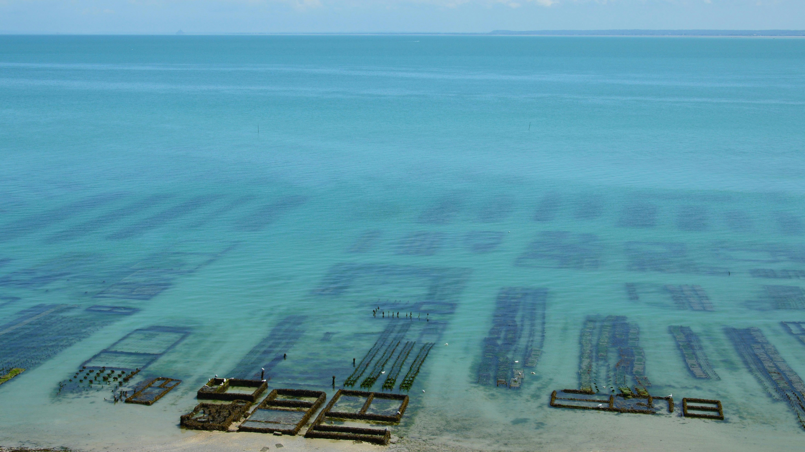

# Prioritizing Potential Marine Aquaculture Zones on the West Coast



<p align="center">
  <em>[Oyster Farm](https://unsplash.com/photos/underwater-oyster-farm-in-clear-turquoise-water-2bM0dDbaXIM)</em>
</p>

## Purpose of this Repository
This repository is for Homework 3 for EDS 223: Geospatial Analysis & Remote Sensing. The analysis determines which Exclusive Economic Zones (EEZ) on the West Coast of the US are best suited to developing marine aquaculture for oysters and California spiny lobsters. Suitable locations were determined based on a range of suitable sea surface temperatures (SST) and depth values for each respective species. A function was created to generalize the work flow for any species and intakes minimum/maximum SST, minimum/maximum depth, and the name of the species. The output is a map of EEZ regions colored by the amount of suitable area in each.


## Package Dependencies
* `tidyverse`
* `sf`
* `terra`
* `tmap`


## File Structure
```
.
├── data
│   ├── average_annual_sst_2008.tif
│   ├── average_annual_sst_2009.tif
│   ├── average_annual_sst_2010.tif
│   ├── average_annual_sst_2011.tif
│   ├── average_annual_sst_2012.tif
│   ├── depth.tif
│   ├── wc_regions_clean.dbf
│   ├── wc_regions_clean.prj
│   ├── wc_regions_clean.shp
│   └── wc_regions_clean.shx
├── README.md
├── west-coast-marine-aquaculture.pdf
└── west-coast-marine-aquaculture.qmd
```

## Data Information & Access

**Suitable Growing Conditions for Marine Life**
This analysis focuses on suitable growing conditions for oysters and . Information on species depth and temperature requirements was found on [SeaLifeBase](https://www.sealifebase.ca/search.php).


**Sea Surface Temperature**
We used average annual sea surface temperature (SST) from 2008-2012 to characterize the average SST within the region. The data we worked with was originally from [NOAA’s 5km Daily Global Satellite Sea Surface Temperature Anomaly v3.1](https://coralreefwatch.noaa.gov/product/5km/index_5km_ssta.php).

Data files:
* `average_annual_sst_2008.tif`
* `average_annual_sst_2009.tif`
* `average_annual_sst_2010.tif`
* `average_annual_sst_2011.tif`
* `average_annual_sst_2012.tif`


**Bathymetry**
To characterize the depth of the ocean we used the [General Bathymetric Chart of the Oceans (GEBCO)](https://www.gebco.net/data-products/gridded-bathymetry-data#area).

Data file: 
* `depth.tif`


**Exclusive Economic Zones**
We designated maritime boundaries using Exclusive Economic Zones off of the west coast of US from [Marineregions.org](https://www.marineregions.org/eez.php).

Data file:
* `wc_regions_clean.shp`

## Authors
Author: [Karolina Sienko](https://github.com/karolinasienko)
Contributor: [Annie Adams](https://github.com/annieradams)

## Citations

Flanders Marine Institute (2023). Maritime Boundaries Geodatabase: Maritime Boundaries and Exclusive Economic Zones (200NM), version 12. Accessed on November 02, 2026 at [https://www.marineregions.org/eez.php](https://www.marineregions.org/eez.php).

GEBCO Bathymetric Compilation Group 2026 (2026). The GEBCO_2026 Grid - a continuous terrain model for oceans and land at 15 arc-second intervals. Accessed on November 02, 2026 at [https://www.gebco.net/data-products/gridded-bathymetry-data#area](https://www.marineregions.org/eez.php).

NOAA Coral Reef Watch (2026). NOAA Coral Reef Watch Version 3.1 Daily Global 5km Satellite Sea Surface Temperature Anomaly Product, 2008–2012. College Park, Maryland, USA: NOAA Coral Reef Watch. Accessed on November 02, 2026 at [https://coralreefwatch.noaa.gov/product/5km/index_5km_ssta.php](https://www.marineregions.org/eez.php).
